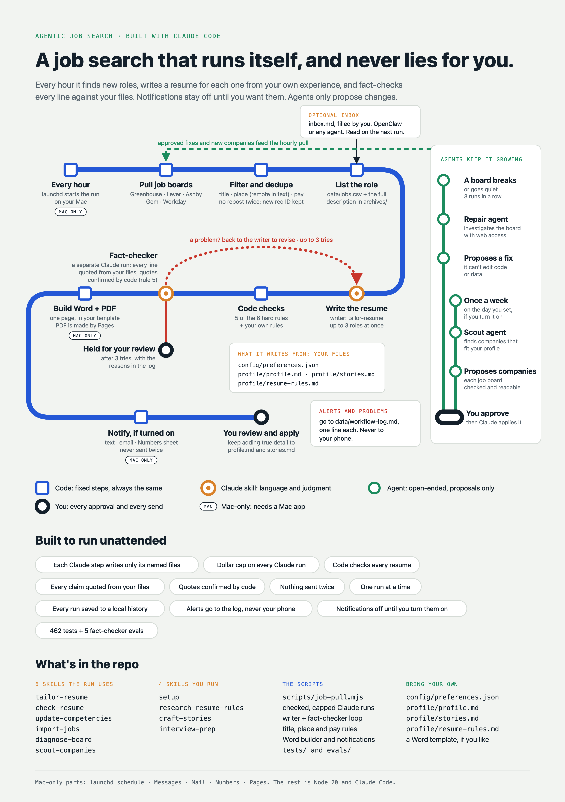
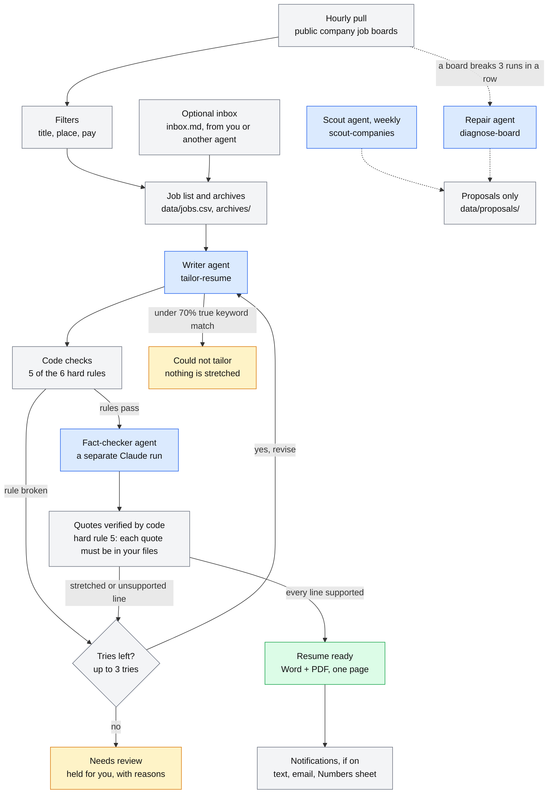

# Agentic Job Search

An hourly job-search pipeline for Mac and Claude Code. It watches the job boards of the companies you pick and writes a fact-checked, one-page resume for each new role, using only your own true experience. Note- if you're looking for zero-effort agentic job search systems that will apply to jobs on your behalf, this is not for you. The job search process should require effort and critical thinking, and most modern agentic job search workflows offload both to AI. in my opinion, you're trading quality and honesty for convenience. This workflow automates the toilsome parts of job seeking (identifying roles, tailoring resumes, interview prep, among others), while ensuring the user is still in control of quality and submission.

## What it does

1. Every hour it reads the public job boards of the companies you choose and keeps the new roles that match your titles, places and pay.
2. It adds them to a job list (and, if you like, a Numbers sheet) and saves each full job description.
3. A writer agent drafts a one-page resume for each role, using only the facts in your own files.
4. Code checks five of the six hard rules. A separate fact-checker agent must then back every line with a quote from your files, and code confirms each quote is really there (hard rule 5). After up to three tries, a resume that still fails is held for you.
5. Resumes that pass become Word and PDF files. Text, email and Numbers notifications are all off until you turn them on.

## How it works

Blue boxes are Claude agents, grey boxes are plain code. Each role ends in one of three states: **Resume ready**, **Needs review** (held for you, with the reasons) or **Could not tailor** (the job asks for more than your true experience covers, so nothing is stretched). The repair agent and the weekly scout only write proposals. Nothing they suggest is applied until you say yes.

Read next: [Setup](docs/SETUP.md), [Architecture](docs/ARCHITECTURE.md), [Customizing](docs/CUSTOMIZING.md), [the made-up example person](examples/README.md) and [the evals](evals/README.md).

## Why it's built this way

- **The writer never grades its own work.** A second Claude run, told to doubt, checks every summary sentence and bullet against your files. When it is unsure, the line counts as stretched.
- **The rules are enforced in code.** Summary length, bullet length, a number in every bullet, time-bound results and keyword coverage are measured by code, not asked for in a prompt. If you edit the hard-rules block in `profile/resume-rules.md`, it is put back at the next run. Your own rules can add to the hard rules but never loosen them.
- **Quotes are verified by code.** For each line, the fact-checker must quote the exact line from your files that backs it. Code confirms the quote is really in `profile/profile.md`, `profile/stories.md` or a resume you finalized. A resume is never its own source, and an invented quote fails.
- **Agents that only propose.** The repair agent and the scout can write one proposal file each. They never change your settings, your data or the code.
- **Limited file access and dollar caps.** Every Claude step runs by itself. It can read files only inside the project folder and write only the one or two files it is named for, and it can't run shell commands. Only the repair agent (which can also open web pages) and the scout (which can also search the web and open pages) reach the internet. Each step has a dollar cap and a 20-minute time limit, and if the writer edits any other resume, that edit is undone.
- **Evals that grow from real failures.** The fact-checker is tested on a true resume and on copies with one planted problem each: a changed number, inflated ownership, work moved to the wrong role, a summary that is a list of keywords. Every real failure becomes a new case before it is fixed. How it works and what each case caught: [docs/EVALS.md](docs/EVALS.md).
- **Nothing is sent twice.** A log of what was sent, kept per resume version, means a rerun or a crash never sends the same resume twice, while a changed resume does go out again. Only one run happens at a time, and every run is saved to a local history you can undo.
- **Tests.** 417 automatic tests (`node --test`) cover the checks, the writer loop, the messages and the settings. They use only the made-up example person and make no Claude calls.

## Quick start

You need a Mac, Claude Code installed and signed in, and Node 20 or newer. It was tested with Claude Code 2.1.317 and Node 20. `node scripts/check-setup.mjs` warns you if your Claude Code is a different version.

Sign in by running `claude` and using `/login` (with a Claude plan, or a Console account to pay by API usage). The login is kept in your Mac's keychain, where the hourly job can use it. An `ANTHROPIC_API_KEY` set only in your shell, for example in `~/.zshrc`, works when you run the pull yourself but isn't seen by the hourly job, which doesn't read your shell's startup files.

1. Get the code with `git clone https://github.com/mwoodwilson/agentic-job-search.git`, open a terminal in its folder (`cd agentic-job-search`) and start Claude Code there with `claude`.
2. Type `/setup`, or paste this message into Claude Code: *Help me set up this project. Use its setup skill and walk me through it one question at a time.* It asks one question at a time: it drafts your profile from your resume (`profile/profile.md` and `profile/stories.md` are living documents: keep adding true detail and every resume gets better), finds each company's job board, sets your rules and notifications, runs a first pull without Claude and offers to turn on the hourly schedule. Prefer to do it by hand? [docs/SETUP.md](docs/SETUP.md) has the same eight steps.
3. After that, new roles get resumes when the hourly job runs, or whenever you run `node scripts/job-pull.mjs`. Finished resumes are in `outputs/resumes/` and the job list is `data/jobs.csv`. Edit the job list in a text editor, not in Numbers: Numbers saves a separate `.numbers` copy, so a change made there never reaches the pipeline.

### New to Claude Code or the terminal?

1. Open the **Terminal** app (Applications › Utilities). You type each command below and press Return.
2. Install Node: download the LTS installer from [nodejs.org](https://nodejs.org) and run it. Check it worked with `node --version` (it should say 20 or higher).
3. Install Claude Code with `curl -fsSL https://claude.ai/install.sh | bash`, then run `claude` and sign in with `/login`. Help is in the [Claude Code docs](https://code.claude.com/docs/en/overview).
4. Get this project with `git clone https://github.com/mwoodwilson/agentic-job-search.git`, then `cd agentic-job-search`. If your Mac offers to install developer tools for `git`, say yes and run the command again.
5. Start Claude Code in that folder with `claude`, then type `/setup` or paste: *Help me set up this project. Use its setup skill and walk me through it one question at a time.* Claude asks one question at a time and does the rest. You can stop and come back to it later.

Everyday commands:

| Command | What it does |
|---|---|
| `node scripts/check-setup.mjs` | Checks Node, Claude Code, your settings and your profile, and names anything still open |
| `node scripts/job-pull.mjs` | One full run, the same one the hourly job makes |
| `node scripts/job-pull.mjs --no-ai` | Only pulls and lists roles; no Claude calls. New roles keep the Status `New`, so the next full run writes (and pays for) a resume for each one. A company's first pull still lands as `Backlog`, even with `--no-ai`. With text or email on, a run that adds roles sends "Job search: N new roles added, no resumes created." (that includes a first pull's `Backlog` roles) |
| `node scripts/job-pull.mjs --no-ai --backlog` | Pulls and lists every new role as `Backlog`: no resumes, no messages, no Claude calls. Set a role's Status to `New` to get a resume for it |
| `node scripts/install-schedule.mjs` | Turns the hourly job on or off to match `schedule.hourly` in your settings |
| `node --test` | The automatic tests |
| `node evals/run-checker.mjs` | The live fact-checker evals (about $1.30) |

Your own files stay on your Mac. Your settings (`config/preferences.json`), your profile files (`profile/profile.md`, `profile/stories.md`, `profile/resume-rules.md`), your data (`data/`, `archives/`, `outputs/`, `inbox.md`) and your run history (`.history/`) are all git-ignored, so they are never committed or pushed. The run history is a separate local git folder, so a `git pull` for a new version never collides with your data. To see what a finished resume looks like, or to try the workflow before writing your own profile, use the made-up person in [examples/](examples/README.md).

## What it costs

The code is free, and a quiet hour makes no Claude calls, so the cost is the Claude usage for the work that does happen. The first time a company's board is read, the roles already open there are listed as `Backlog`, with no resumes, so adding a company never starts a pile of paid resumes at once. Only roles that appear after that get resumes by themselves.

- A full resume, with the writer, the fact-checker and any retries, typically costs about $2 to $4 (one measured run: $2.92 over three tries; runs have ranged from about $1 to $5). It depends on your default Claude model and on how many tries a resume needs, and retries can go up to the per-step caps below.
- A run that adds postings to an archive also updates that role family's competencies file, which is one more Claude step.
- Each Claude step is capped by `claude.maxUsdPerStep` (default $3). A step stops when it reaches its cap.
- The weekly scout is off by default. A run costs about $5 and is capped by `claude.maxUsdScout`.
- The fact-checker evals measured $1.31 for their 5 cases.
- On a Claude Pro or Max plan this counts against your plan usage. With an API key it is billed to you.
- Nothing else costs money: the job boards are public, and notifications use the apps already on your Mac.

## Mac-only parts

Everything else is Node and Claude Code, and it was only tested on a Mac.

| Part | What it uses | Without it |
|---|---|---|
| Hourly schedule | launchd, set up by `node scripts/install-schedule.mjs` | Run `node scripts/job-pull.mjs` yourself |
| PDF files | The Pages app | You get Word files only |
| Text message notifications | The Messages app | Stays off |
| Email notifications | The Mail app | Stays off |
| Numbers job list | The Numbers app and iCloud Drive | Stays off |

The first time one of these runs, macOS asks whether it may control Messages, Mail, Numbers or Pages. Choose Allow.

## Optional job inbox

Found a job somewhere the pipeline doesn't watch? Paste it into `inbox.md` (the first run creates it), or let another agent such as OpenClaw add it. The next run reads each entry, adds it to your job list and archives, and writes a resume for it. The entry format and an example prompt for an agent are in [integrations/optional-inbox.md](integrations/optional-inbox.md).

## Built by

Built by Matthew Wilson ([LinkedIn](https://www.linkedin.com/in/matthewwoodwilson))

I built it because I believe there should still be integrity in the job search process amidst the onslaught of agentic AI.

## License

MIT. See [LICENSE](LICENSE).
